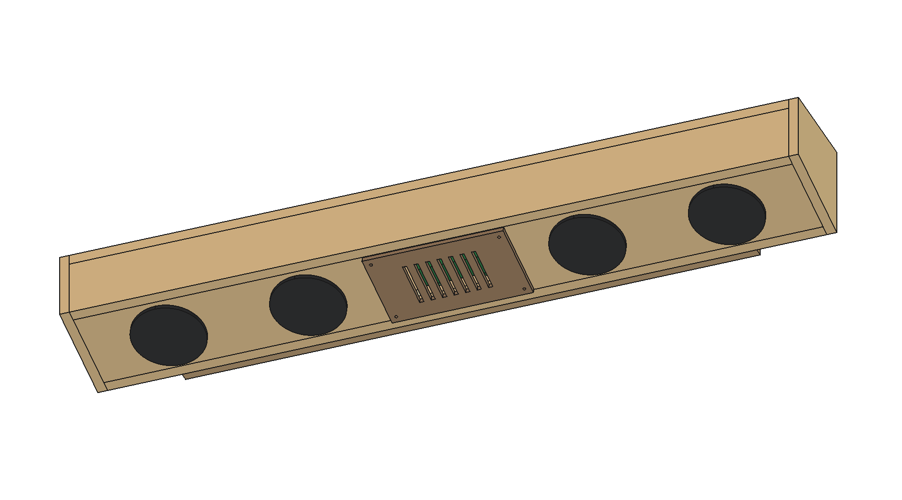
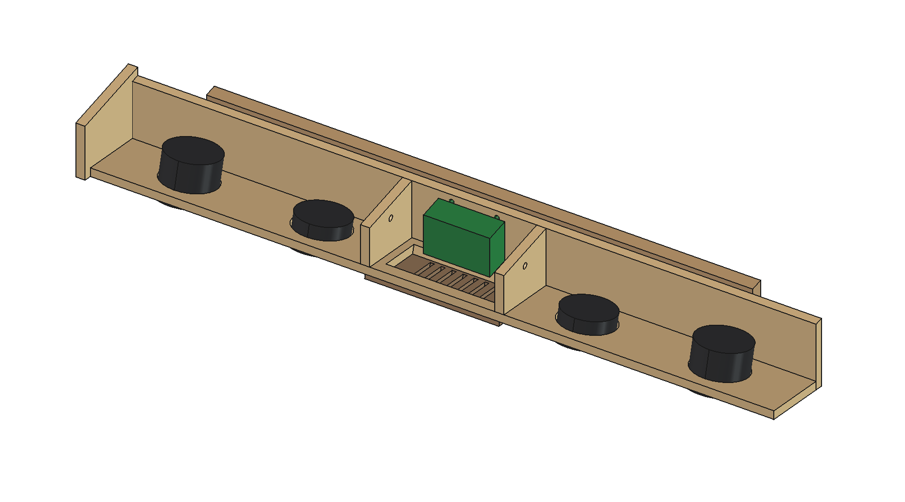
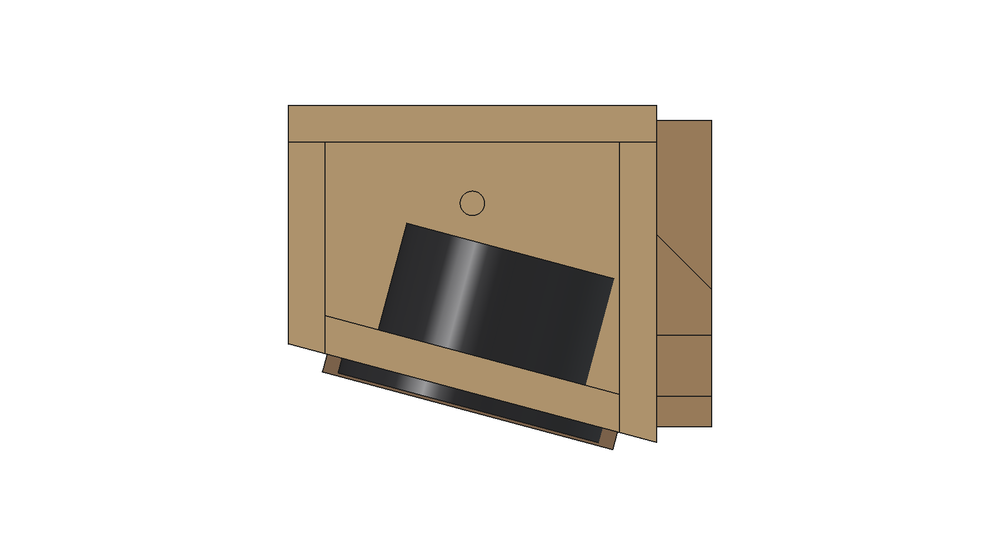

# Barre de son murale Robine Wake

Enceinte principale de Robine Wake : une barre fixée au mur au-dessus de la tête
de lit, dont les haut-parleurs tirent vers le bas à travers un baffle incliné de
15° vers l'oreiller. Elle contient le Raspberry Pi 3 B+, la HiFiBerry Amp2 et
deux ensembles de haut-parleurs (un par canal).



## Architecture

| Zone | Contenu |
|---|---|
| chambre gauche | haut-parleur large bande 3" + radiateur passif, volume clos ≈ 1,96 L |
| baie centrale | Pi 3 B+ et Amp2 sur entretoises fixées au panneau arrière, passe-câble d'alimentation |
| chambre droite | identique à la gauche, en miroir |

- Encombrement : 900 × 120 × 110 mm (longueur × profondeur × hauteur).
- Caisson en contreplaqué bouleau ou MDF de 12 mm, assemblé collé-vissé.
- Les deux cloisons isolent les chambres de la baie : les haut-parleurs restent
  en charge close et l'électronique ne prend pas la pression acoustique.
- La trappe vissée sous la baie (contreplaqué de 6 mm) donne accès à la microSD
  et au câblage sans laisser la carte accessible depuis l'extérieur.
- L'air entre par les fentes de la trappe et sort par celles du dessus. Aucune
  pièce chaude n'est au contact de la literie.
- Fixation par tasseau français (biseau à 45°) avec une cale basse de même
  épaisseur. Le câble d'alimentation sort à l'arrière, dans l'espace libre de
  18 mm derrière la barre.




## Génération

Le modèle est entièrement paramétrique : toutes les cotes sont dans
`SoundbarParameters`, au début de `design_soundbar.py`.

```sh
cd hardware/robine_enclosure/soundbar
/Applications/FreeCAD.app/Contents/Resources/bin/freecadcmd design_soundbar.py
/Applications/FreeCAD.app/Contents/MacOS/FreeCAD render_previews.py   # aperçus PNG
```

Le script écrit dans `generated/` :

- `robine-soundbar.FCStd` : assemblage FreeCAD (groupes Enclosure, WallMount,
  Reference) ;
- `robine-soundbar.step` : assemblage complet, y compris les volumes de
  référence des haut-parleurs et de l'électronique ;
- `parts/*.step|stl` : chaque pièce à fabriquer, en position montée ;
- `cut-list.md` : liste de débit, masses, volume des chambres et résultat des
  vérifications ;
- `parameters.json` : paramètres utilisés.

Le script vérifie qu'aucun haut-parleur, ni la pile Pi + Amp2, ne traverse un
panneau, que les flasques ne se chevauchent pas et qu'ils restent hors de la
baie. Si une vérification échoue, `freecadcmd` renvoie un code non nul.

## Avant la découpe

Les haut-parleurs ne sont pas encore choisis. Les valeurs par défaut décrivent
un large bande de 3" générique (découpe Ø 72, flasque Ø 88, profondeur 48 mm)
et un radiateur passif de même diamètre. Reporter les cotes de la fiche
technique dans `SoundbarParameters`, puis régénérer. Le volume net par chambre
doit correspondre à la charge recommandée pour le couple haut-parleur/radiateur.

À valider physiquement :

1. largeur réelle du lit et de la tête de lit, pour ajuster `length` ;
2. angle du baffle (`baffle_tilt_deg`) selon la hauteur de pose au-dessus de
   l'oreiller ;
3. hauteur réelle de la pile Pi + Amp2 avec ses borniers (`pi_stack_depth`) ;
4. chauffe de l'Amp2 après 30 minutes de musique, trappe fermée (voir
   [10-002](../../../docs/specs/10/002-hardware-profile/spec.md)).

Points de fabrication : chants du baffle, de la façade et du panneau arrière
biseautés à 15°, joints des chambres rendus étanches au mastic, laine
acoustique ou ouate polyester dans les chambres, tissu acoustique tendu sur le
baffle, passe-fils rebouchés après câblage.
